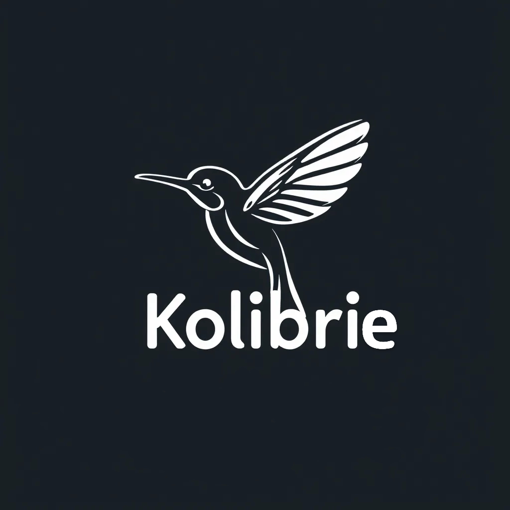

# Kolibrie

<p align="center">
    
</p>

<!--  -->
[](https://github.com/StreamIntelligenceLab/Kolibrie/tree/main)


[](https://discord.gg/KcFXrUUyYm)
<!---->

**Kolibrie** is a high-performance, concurrent, and feature-rich SPARQL query engine implemented in Rust. Designed for scalability and efficiency, it leverages Rust's robust concurrency model and advanced optimizations, including SIMD (Single Instruction, Multiple Data) and parallel processing with Rayon, to handle large-scale RDF (Resource Description Framework) datasets seamlessly.

With a comprehensive API, **Kolibrie** facilitates parsing, storing, and querying RDF data using SPARQL, Turtle, and N3 formats. Its advanced filtering, aggregation, join operations, and sophisticated optimization strategies make it a suitable choice for applications requiring complex semantic data processing. Additionally, the integration of the Volcano Optimizer and Knowledge Graph capabilities empowers users to perform cost-effective query planning and leverage rule-based inference for enhanced data insights.

## Research Context

**Kolibrie** is developed within the [Stream Intelligence Lab](https://kulak.kuleuven.be/nl/onderzoek/Onderzoeksdomeinen/stream-intelligence-lab) at KU Leuven, under the supervision of Prof. Pieter Bonte. The Stream Intelligence Lab focuses on **Stream Reasoning**, an emerging research field that integrates logic-based techniques from artificial intelligence with data-driven machine learning approaches to derive timely and actionable insights from continuous data streams. Our research emphasizes applications in the Internet of Things (IoT) and Edge processing, enabling real-time decision-making in dynamic environments such as autonomous vehicles, robotics, and web analytics.

For more information about our research and ongoing projects, please visit the [Stream Intelligence Lab website](https://kulak.kuleuven.be/nl/onderzoek/Onderzoeksdomeinen/stream-intelligence-lab).

## Features

- **Efficient RDF Parsing**: Supports parsing RDF/XML, Turtle, and N3 formats with robust error handling and prefix management.
- **Concurrent Processing**: Utilizes Rayon and Crossbeam for parallel data processing, ensuring optimal performance on multi-core systems.
- **SIMD Optimizations**: Implements SIMD instructions for accelerated query filtering and aggregation.
- **Flexible Querying**: Supports complex SPARQL queries, including SELECT, INSERT, FILTER, GROUP BY, and VALUES clauses.
- **Volcano Optimizer**: Incorporates a cost-based query optimizer based on the Volcano model to determine the most efficient execution plans.
- **Reasoner**: Provides robust support for building and querying knowledge graphs, including ABox (instance-level) and TBox (schema-level) assertions, dynamic rule-based inference, and backward chaining.
- **Streaming and Sliding Windows**: Handles timestamped triples and sliding window operations for time-based data analysis.
- **Machine Learning Integration**: Seamlessly integrates with Python ML frameworks through PyO3 bindings.
- **Typed RDF terms**: Literals keep their datatype and language tag, blank node labels are scoped to the document they came from, and every reader spells a term the same way, so data loaded as Turtle joins against data loaded as N-Triples.
- **Data exchange**: Skolemisation replaces blank nodes with globally unique IRIs, so two systems can merge each other's graphs without fusing unrelated nodes.
- **Dictionary encoding**: Terms are interned as `u32` ids, which is what makes a join a comparison of integers rather than of strings.
- **One dependency**: [`kolibrie-api`](kolibrie-api) re-exports the workspace, so a consumer names one crate instead of four.
- **Python bindings**: The query API, the RSP engine, Datalog reasoning and the term helpers, all from Python.

## Installation

### Native Installation

Ensure you have [Rust](https://www.rust-lang.org/tools/install) installed (version 1.60 or higher).

Clone the repository:

```bash
git clone https://github.com/StreamIntelligenceLab/Kolibrie.git
cd Kolibrie
```

Build the project:

```bash
cargo build --release
```

Then, include it in your project:

```rust
use kolibrie::sparql_database::SparqlDatabase;
```

### WebUI

To run webui:
```bash
cargo run --bin kolibrie-http-server
```

After that in the browser type `localhost:8080` or `0.0.0.0:8080`

### Docker Installation

**Kolibrie** provides Docker support for running the web UI or opening a development shell. The Docker setup automatically handles Rust and Python ML dependencies which are fully integrated into Kolibrie.

#### Prerequisites

- [Docker](https://docs.docker.com/get-docker/) installed
- [Docker Compose](https://docs.docker.com/compose/install/) installed

#### Quick Start with Docker Compose

Kolibrie offers two deployment profiles:

**1. Web UI Build (Default)**

Runs with web UI on port 8080:
```bash
docker compose up --build
# or explicitly:
docker compose --profile cpu up --build
```

Access the web UI at `http://localhost:8080`

**2. Development Build**

Interactive shell for development:
```bash
docker compose --profile dev up --build
```

This drops you into a bash shell with full access to Kolibrie tools.

#### Running Without Docker Compose

If you prefer using Docker directly:

**CPU Build with Web UI:**

Build:
```bash
docker build \
  --build-arg ENABLE_WEB_UI=true \
  -t kolibrie:cpu \
  .
```

Run:
```bash
docker run -d \
  --name kolibrie \
  -p 8080:8080 \
  -v $(pwd)/data:/app/data \
  -v $(pwd)/models:/app/ml/examples/models \
  kolibrie:cpu
```

**Development Build (Shell Access):**

Build:
```bash
docker build \
  --build-arg ENABLE_WEB_UI=false \
  -t kolibrie:dev \
  .
```

Run:
```bash
docker run -it \
  --name kolibrie-dev \
  -v $(pwd):/app \
  kolibrie:dev \
  bash
```

## Usage

### Initializing the Database

Create a new instance of the `SparqlDatabase`:

```rust
use kolibrie::sparql_database::SparqlDatabase;

fn main() {
    let mut db = SparqlDatabase::new();
    // Your code here
}
```

<!-- readme-examples: preamble
use kolibrie::prelude::*;
use kolibrie::sparql_database::SparqlDatabase;
use kolibrie::execute_query::{execute, execute_sparql_update};
let mut db = SparqlDatabase::new();
let mut other_db = SparqlDatabase::new();
-->

The snippets that follow assume that `db`, and the imports above, are in scope.

### Parsing RDF Data

**Kolibrie** supports parsing RDF data from files or strings in various formats. 

#### Parsing RDF/XML from a File

```rust
db.parse_rdf_from_file("data.rdf");
```

#### Parsing RDF/XML from a String

```rust
let rdf_data = r#"
<?xml version="1.0" encoding="UTF-8"?>
<rdf:RDF 
    xmlns:rdf="http://www.w3.org/1999/02/22-rdf-syntax-ns#"
    xmlns:foaf="http://xmlns.com/foaf/0. 1/">
    
    <rdf:Description rdf:about="http://example.org/alice">
        <foaf:name>Alice</foaf:name>
        <foaf:age>30</foaf:age>
    </rdf:Description>
</rdf:RDF>
"#;

db.parse_rdf(rdf_data);
```

#### Parsing Turtle Data from a String

```rust
let turtle_data = r#"
@prefix ex: <http://example.org/> .

ex:Alice ex:knows ex:Bob . 
ex:Bob ex:knows ex:Charlie .
"#;

db.parse_turtle(turtle_data);
```

#### Parsing N3 Data from a String

```rust
let n3_data = r#"
@prefix ex: <http://example.org/> .

ex:Alice ex:knows ex:Bob .
ex:Bob ex:knows ex:Charlie .
"#;

db.parse_n3(n3_data);
```

#### Parsing N-Triples from a String

```rust
let ntriples_data = r#"
<http://example.org/john> <http://example.org/hasFriend> <http://example.org/jane> . 
<http://example.org/jane> <http://example.org/name> "Jane Doe" . 
<http://example.org/john> <http://example.org/age> "30"^^<http://www.w3.org/2001/XMLSchema#integer> .
"#;

db.parse_ntriples_and_add(ntriples_data);
```

### Adding Triples Programmatically

Add individual triples directly to the database:

```rust
db.add_triple_parts(
    "http://example.org/alice",
    "http://xmlns.com/foaf/0.1/name",
    "Alice"
);

db.add_triple_parts(
    "http://example.org/alice",
    "http://xmlns.com/foaf/0.1/age",
    "30"
);
```

### Executing SPARQL Queries

Execute SPARQL queries to retrieve and manipulate data. 

#### Basic SELECT Query

```rust
let sparql_query = r#"
PREFIX ex: <http://example.org/>
SELECT ?s ?o
WHERE {
    ?s ex:knows ?o .
}
"#;

let results = execute(sparql_query, &mut db)
    .expect("the query should run")
    .into_rows();

for row in results {
    println!("Subject: {}, Object: {}", row[0], row[1]);
}
```

#### Named graphs, `GRAPH`, and `UNION`

Kolibrie's standard SELECT and Update paths use one architecture: the existing
`nom` parser builds recursive group patterns, which are lowered into the same
logical plan, Streamertail optimizer, and physical executor. There is no
separate parser or evaluator for `GRAPH`, `UNION`, or Update `WHERE` patterns.
The unified path supports recursive `GRAPH` patterns with fixed or variable
graph names, nested groups, and multiset `UNION`:

```rust
let rows = execute(
    r#"
    PREFIX ex: <http://example.org/>
    SELECT DISTINCT ?g ?item WHERE {
        { GRAPH ?g { ?item ex:status "active" } }
        UNION
        { GRAPH ?g { { ?item ex:status "pending" } } }
    }
    "#,
    &mut db,
).expect("the query should run").into_rows();
```

`GRAPH <name>` reads only that named graph. `GRAPH ?g` iterates named graph
identities and binds `?g`; the default graph is never included. Without
`DISTINCT`, duplicate solutions contributed by `UNION` are retained.

Dataset clauses replace the query dataset. Multiple `FROM` graphs are merged
into the query default graph with duplicate triples suppressed. Once any
dataset clause is present, only graphs listed by `FROM NAMED` are visible to
`GRAPH`; `FROM NAMED` without `FROM` gives an empty query default, while
`FROM` without `FROM NAMED` exposes no named graphs. With no dataset clauses,
the physical default graph and all catalogued named graphs are visible.

#### Supported SPARQL Update forms

The error-preserving Rust API accepts exactly the six Update forms listed
below. Default and named-graph templates can be mixed in the same operation,
and each `WHERE` uses the same parser, logical planner, optimizer, and executor
as SELECT.

```rust
execute_sparql_update(
    r#"
    PREFIX ex: <http://example.org/>
    DELETE { ?s ex:oldValue ?value }
    INSERT { GRAPH ex:archive { ?s ex:value ?value } }
    WHERE  { ?s ex:oldValue ?value }
    "#,
    &mut db,
)
.expect("the update should run");
```

Supported forms are `INSERT DATA`, `DELETE DATA`, `INSERT ... WHERE`,
`DELETE ... WHERE`, combined `DELETE/INSERT ... WHERE`, and `DELETE WHERE`.
The `WHERE` pattern is evaluated once before changes are applied, with deletes
performed before inserts. Python exposes the same behavior as
`SparqlDatabase.update()`. Other SPARQL 1.1 Update forms such as `WITH`,
`USING`, `LOAD`, and graph-management operations are not part of this release.

#### Query with FILTER

```rust
let sparql = r#"
PREFIX ex: <http://example.org/vocab#>

SELECT ?name ?attendees
WHERE {
    ?event ex:name ?name .
    ?event ex:attendees ?attendees . 
    FILTER (?attendees > 50)
}
"#;

let results = execute(sparql, &mut db).expect("the query should run").into_rows();

for row in results {
    println! ("Event: {}, Attendees: {}", row[0], row[1]);
}
```

#### Query with OR Operator

```rust
let sparql = r#"
PREFIX ex: <http://example.org/vocab#>

SELECT ?name ?type ?attendees
WHERE {
    ?event ex:name ?name . 
    ?event ex:type ?type .
    ?event ex:attendees ?attendees . 
    FILTER (?type = "Technical" || ?type = "Academic")
}
"#;

let results = execute(sparql, &mut db).expect("the query should run").into_rows();

for row in results {
    if let [name, type_, attendees] = &row[.. ] {
        println!("Name: {}, Type: {}, Attendees: {}", name, type_, attendees);
    }
}
```

#### Query with LIMIT

```rust
let sparql = r#"
PREFIX ex: <http://example.org/vocab#>

SELECT ?name ?type
WHERE {
    ?event ex:name ?name .
    ?event ex:type ?type .
    FILTER (?type = "Technical" || ?type = "Academic")
}
LIMIT 2
"#;

let results = execute(sparql, &mut db).expect("the query should run").into_rows();

for row in results {
    println!("Name: {}, Type: {}", row[0], row[1]);
}
```

#### Query with Aggregations

```rust
let sparql = r#"
PREFIX ds: <https://data.cityofchicago.org/resource/xzkq-xp2w/>

SELECT AVG(?salary) AS ?average_salary
WHERE {
    ?employee ds:annual_salary ?salary
}
GROUPBY ?average_salary
"#;

let results = execute(sparql, &mut db).expect("the query should run").into_rows();

for row in results {
    if let [avg_salary] = &row[.. ] {
        println!("Average Salary: {}", avg_salary);
    }
}
```

**Supported Aggregations:**
- `AVG(? var)` - Calculate average
- `COUNT(?var)` - Count occurrences
- `SUM(?var)` - Sum values
- `MIN(?var)` - Find minimum
- `MAX(? var)` - Find maximum

#### Query with String Functions

```rust
let sparql = r#"
PREFIX foaf: <http://xmlns.com/foaf/0.1/>

SELECT ?name
WHERE {
    ?person foaf:givenName ?first .
    ?person foaf:surname ?last
    BIND(CONCAT(?first, " ", ?last) AS ?name)
}
"#;

let results = execute(sparql, &mut db).expect("the query should run").into_rows();

for row in results {
    println!("Full Name: {}", row[0]);
}
```

#### Nested Queries

```rust
let sparql = r#"
PREFIX ex: <http://example.org/>

SELECT ?friendName
WHERE {
    ?person ex:name "Alice" .
    ?person ex:knows ?friend
    {
        SELECT ?friend ?friendName
        WHERE {
            ?friend ex:name ?friendName . 
        }
    }
}"#;

let results = execute(sparql, &mut db).expect("the query should run").into_rows();

for row in results {
    println!("Alice's Friend: {}", row[0]);
}
```

### Using the Query Builder API

The Query Builder provides a fluent interface for programmatic query construction. 

#### Basic Query Building

```rust
// Get all objects for a specific predicate
let results = db.query()
    .with_predicate("http://xmlns.com/foaf/0.1/name")
    .get_objects();

for object in results {
    println!("Name: {}", object);
}
```

#### Query with Filtering

```rust
let results = db.query()
    .with_predicate("http://xmlns.com/foaf/0.1/age")
    .filter(|triple| {
        // Custom filter logic
        db.dictionary().decode(triple.object)
            .and_then(|age| age.parse::<i32>().ok())
            .map(|age| age > 25)
            .unwrap_or(false)
    })
    .get_decoded_triples();

for (subject, predicate, object) in results {
    println!("{} is {} years old", subject, object);
}
```

#### Query with Joins

```rust
let other_db = SparqlDatabase::new();
// ...  populate other_db ...

let results = db.query()
    .join(&other_db)
    .join_on_subject()
    .get_triples();
```

#### Query with Sorting, Limiting, and Distinct

```rust
let results = db.query()
    .with_predicate("http://xmlns.com/foaf/0.1/name")
    .order_by(|triple| {
        db.dictionary().decode(triple.object).unwrap().to_string()
    })
    .distinct()
    .limit(10)
    .offset(5)
    .get_decoded_triples();

for (subject, predicate, object) in results {
    println!("{} - {} - {}", subject, predicate, object);
}
```

### Using the Volcano Optimizer

The **Volcano Optimizer** is integrated within **Kolibrie** to optimize query execution plans based on cost estimation. It transforms logical query plans into efficient physical plans using various join strategies and applies cost-based decisions to select the most performant execution path.

#### Example: Optimized Query Execution

```rust
use kolibrie::execute_query::*;
use kolibrie::sparql_database::*;

fn main() {
    let mut db = SparqlDatabase::new();

    // Parse N-Triples data
    let ntriples_data = r#"
<http://example.org/john> <http://example.org/hasFriend> <http://example.org/jane> .
<http://example.org/jane> <http://example.org/name> "Jane Doe" .
<http://example.org/john> <http://example.org/name> "John Smith" . 
<http://example.org/jane> <http://example.org/age> "25"^^<http://www.w3.org/2001/XMLSchema#integer> .
<http://example.org/john> <http://example.org/age> "30"^^<http://www. w3.org/2001/XMLSchema#integer> .
    "#;

    db.parse_ntriples_and_add(ntriples_data);
    
    // Build statistics for the optimizer
    db.get_or_build_stats();

    // Define the SPARQL query
    let sparql_query = r#"
    PREFIX ex: <http://example.org/>
    SELECT ?person ?friend ?friendName
    WHERE {
        ?person ex:hasFriend ?friend .
        ?friend ex:name ?friendName .
    }
    "#;

    // Execute the query with optimized plan
    let results = execute(sparql_query, &mut db).expect("the query should run").into_rows();

    for row in results {
        println!("Person: {}, Friend: {}, Friend's Name: {}", row[0], row[1], row[2]);
    }
}
```

### Working with RDF terms

A term is stored as the text that identifies it, and that text is its identity: two
terms spelled alike share one dictionary id and cannot be told apart again. So a
literal carries its datatype, and reading a *value* out of one is an operation rather
than a cast.

<!-- readme-examples: preamble none -->

```rust
use kolibrie::sparql_database::SparqlDatabase;
use shared::rdf_term::{kind_of, numeric_value, spell_literal, TermKind};

fn main() {
    const XSD_INTEGER: &str = "http://www.w3.org/2001/XMLSchema#integer";

    // A literal is spelled bare where it can be and quoted where it must be, so a
    // plain literal and an IRI keep the text they always had.
    assert_eq!(spell_literal("25", None, None), "25");
    assert_eq!(
        spell_literal("25", Some(XSD_INTEGER), None),
        "\"25\"^^<http://www.w3.org/2001/XMLSchema#integer>"
    );

    // RDF 1.1 §3.3: a plain literal *is* an xsd:string literal, so they are one term.
    assert_eq!(
        spell_literal("25", Some("http://www.w3.org/2001/XMLSchema#string"), None),
        spell_literal("25", None, None)
    );

    // The number lives in the lexical form, not the spelling.
    let typed = spell_literal("30", Some(XSD_INTEGER), None);
    assert_eq!(numeric_value(&typed), Some(30.0));
    assert_eq!(kind_of(&typed), TermKind::Literal);
    assert_eq!(kind_of("http://example.org/alice"), TermKind::Iri);

    // Which is what lets the engine aggregate typed data.
    let mut db = SparqlDatabase::new();
    db.parse_ntriples_and_add(&format!(
        "<urn:a> <urn:age> \"30\"^^<{XSD_INTEGER}> .\n<urn:b> <urn:age> \"12\"^^<{XSD_INTEGER}> .\n"
    ));
    let rows = kolibrie::execute_query::execute(
        "SELECT SUM(?age) WHERE { ?s <urn:age> ?age }",
        &mut db,
    )
    .expect("the query should run")
    .into_rows();
    assert_eq!(rows, vec![vec!["42".to_string()]]);
}
```

#### Blank nodes and exchanging data

A blank node label identifies a node only within the document it came from, so the
readers scope it. Publishing a graph for another system to merge means replacing
blank nodes with IRIs, which RDF 1.1 §3.5 calls skolemisation:

```rust
use kolibrie::sparql_database::SparqlDatabase;

fn main() {
    let mut db = SparqlDatabase::new();
    db.parse_ntriples_and_add("_:b <urn:reading> \"1\" .\n");

    // Document-local, and sound only inside this store: a second instance counts
    // its own scopes from one and would mint the same label.
    assert!(db.generate_ntriples().contains("_:kolibrie-doc-"));

    // Under an authority you control, the IRI is global, so a merge is safe. The
    // base is required for exactly that reason.
    let published = db.generate_ntriples_skolemised("http://alice.example");
    assert!(published.contains("<http://alice.example/.well-known/genid/"));
    assert!(!published.contains("_:"));
}
```

<!-- readme-examples: preamble
use kolibrie::prelude::*;
use kolibrie::sparql_database::SparqlDatabase;
use kolibrie::execute_query::{execute, execute_sparql_update};
let mut db = SparqlDatabase::new();
let mut other_db = SparqlDatabase::new();
-->

### Working with the Reasoner

The **Reasoner** component allows you to build and manage semantic networks with instance-level (ABox) information. It supports dynamic rule-based inference using forward chaining, backward chaining, and semi-naive evaluation to derive new knowledge from existing data.

#### Example: Building and Querying a Reasoner

```rust
use datalog::reasoning::Reasoner;
use shared::terms::Term;
use shared::rule::Rule;

fn main() {
    let mut kg = Reasoner::new();

    // Add ABox triples (instance-level data)
    kg.add_abox_triple("Alice", "parentOf", "Bob");
    kg.add_abox_triple("Bob", "parentOf", "Charlie");

    // Define a transitivity rule for ancestorOf relationship
    // Rule: parentOf(X, Y) ∧ parentOf(Y, Z) → ancestorOf(X, Z)
    let ancestor_rule = Rule {
        negative_premise: vec![],
        premise: vec![
            (
                Term::Variable("X".to_string()),
                Term::Constant(kg.encode_term("parentOf")),
                Term::Variable("Y".to_string()),
            ),
            (
                Term::Variable("Y". to_string()),
                Term::Constant(kg.encode_term("parentOf")),
                Term::Variable("Z".to_string()),
            ),
        ],
        conclusion: vec![
            (
                Term::Variable("X".to_string()),
                Term::Constant(kg.encode_term("ancestorOf")),
                Term::Variable("Z".to_string()),
            )
        ],
        filters: vec![],
    };

    kg.add_rule(ancestor_rule);

    // Infer new facts using forward chaining
    let inferred_facts = kg.infer_new_facts();
    
    println!("Inferred {} new facts", inferred_facts.len());

    // Query the Knowledge Graph for ancestorOf relationships
    let results = kg.query_abox(
        Some("Alice"),
        Some("ancestorOf"),
        None,
    );

    for triple in results {
        println!(
            "{} is ancestor of {}",
            kg.decode_term(triple.subject).unwrap(),
            kg.decode_term(triple.object).unwrap()
        );
    }
}
```

**Output:**
```
Inferred 1 new facts
Alice is ancestor of Charlie
```

### Machine Learning Integration

**All machine learning examples can be found [here](https://github.com/StreamIntelligenceLab/Kolibrie/tree/main/kolibrie/examples/sparql_syntax/combination)**.

## API documentation

Two generated references, neither written by hand:

- **[`cargo doc --workspace --open`]** is the authority. It carries the types, the
  bounds, the panics and the prose, and it cannot disagree with the code because it
  *is* the code.
- **[`docs/api.md`](docs/api.md)** is the index: every public item, by crate and
  file, generated by `scripts/api_surface.py`. It exists so a change to the public
  surface shows up in a diff.

How the workspace fits together — the crate graph, the modules of `kolibrie`
arranged into layers, and what depends on what — is in
[`docs/architecture.md`](docs/architecture.md), generated by
`scripts/module_graph.py`.

There used to be 371 lines here restating method signatures by hand, and they
drifted: three methods that no longer existed were documented for a while after they
were removed, here and in five translations that are gone for the same reason --
nothing checked any of them. `scripts/verify.sh` now checks that `docs/api.md`
matches the source and that every example in this README still compiles, so neither
can go stale quietly again.

[`cargo doc --workspace --open`]: https://doc.rust-lang.org/cargo/commands/cargo-doc.html

## How to Contribute

### Submitting Issues
Use the Issue Tracker to submit bug reports and feature/enhancement requests. Before submitting a new issue, ensure that there is no similar open issue.

### Manual Testing
Anyone manually testing the code and reporting bugs or suggestions for enhancements in the Issue Tracker are very welcome!

### Submitting Pull Requests
Patches/fixes are accepted in form of pull requests (PRs). Make sure the issue the pull request addresses is open in the Issue Tracker.

Submitted pull request is deemed to have agreed to publish under Mozilla Public License Version 2.0.

## Community

Join our [Discord community](https://discord.gg/KcFXrUUyYm) to discuss Kolibrie, ask questions, and share your experiences.

## License

Kolibrie is licensed under the [MPL-2.0 License](LICENSE).
