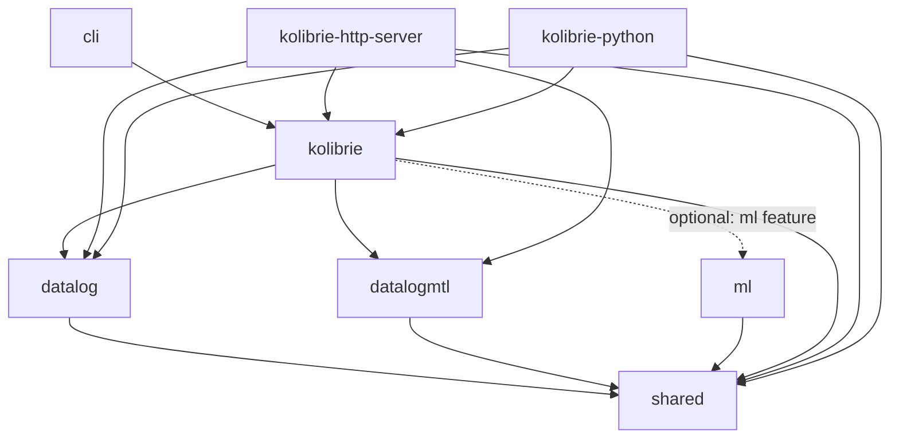
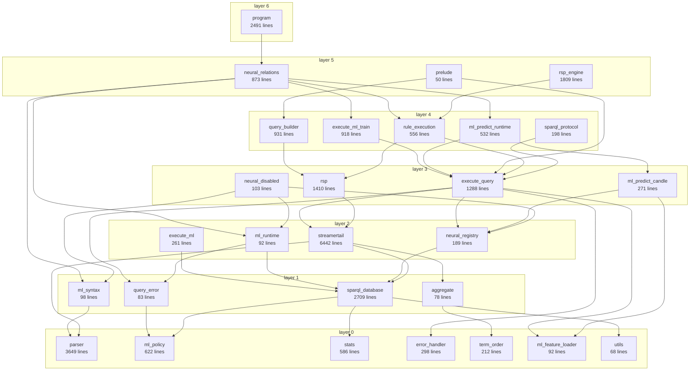

# Architecture

Generated from the code, not drawn by hand: every edge below is a `crate::<module>`
reference that exists in the source. Doc-comment links are excluded, because a link
is not a dependency. `scripts/module_graph.py` reproduces all of it.

## Workspace crates



`shared` is the vocabulary every crate agrees on: `Dictionary`, `Triple`, `Term`,
`Rule`, and the parsed-query AST. `datalog` and `datalogmtl` are reasoners over that
vocabulary rather than layers on the engine, which is why neither depends on
`kolibrie`.

## Modules inside `kolibrie`

28 modules, 88 dependency edges, arranged in 7 layers by
longest path. **The graph is acyclic** — no module participates in a dependency
cycle, verified with Tarjan's algorithm rather than asserted.

The diagram shows the *transitive reduction*: 40 of the 88 edges,
with those implied by a longer path removed. Reachability is identical and the full
set is in the table below. Drawing all 88 is unreadable.



Arrows point from a module to what it depends on, so they run downward and
layer 0 is the floor: nothing below it to depend on.

### Every module and its direct dependencies

The authoritative list: all 88 edges, not the reduced set.

| layer | module | lines | depends on |
|---|---|---:|---|
| 0 | `parser` | 3649 | — nothing in the crate |
| 0 | `ml_policy` | 622 | — nothing in the crate |
| 0 | `stats` | 586 | — nothing in the crate |
| 0 | `error_handler` | 298 | — nothing in the crate |
| 0 | `term_order` | 212 | — nothing in the crate |
| 0 | `ml_feature_loader` | 92 | — nothing in the crate |
| 0 | `utils` | 68 | — nothing in the crate |
| 1 | `sparql_database` | 2709 | `ml_policy`, `stats`, `utils` |
| 1 | `ml_syntax` | 98 | `parser` |
| 1 | `query_error` | 83 | `ml_policy` |
| 1 | `aggregate` | 78 | `term_order` |
| 2 | `streamertail_optimizer` | 6442 | `aggregate`, `parser`, `sparql_database`, `stats`, `term_order` |
| 2 | `execute_ml` | 261 | `ml_policy`, `sparql_database` |
| 2 | `neural_registry` | 189 | `ml_policy`, `sparql_database` |
| 2 | `ml_runtime` | 92 | `query_error`, `sparql_database` |
| 3 | `rsp` | 1410 | `sparql_database`, `streamertail_optimizer` |
| 3 | `execute_query` | 1288 | `aggregate`, `error_handler`, `ml_feature_loader`, `ml_policy`, `neural_registry`, `parser`, `query_error`, `sparql_database`, `stats`, `streamertail_optimizer`, `term_order` |
| 3 | `ml_predict_candle` | 271 | `ml_feature_loader`, `neural_registry`, `sparql_database` |
| 3 | `neural_relations_disabled` | 103 | `ml_policy`, `ml_runtime`, `ml_syntax`, `neural_registry`, `query_error`, `sparql_database` |
| 4 | `query_builder` | 931 | `rsp`, `sparql_database` |
| 4 | `execute_ml_train` | 918 | `execute_query`, `ml_feature_loader`, `neural_registry`, `sparql_database` |
| 4 | `rule_execution` | 556 | `execute_query`, `neural_registry`, `parser`, `rsp`, `sparql_database` |
| 4 | `ml_predict_runtime` | 532 | `execute_query`, `ml_feature_loader`, `ml_predict_candle`, `sparql_database` |
| 4 | `sparql_protocol` | 198 | `execute_query`, `ml_policy`, `sparql_database` |
| 5 | `rsp_engine` | 1809 | `parser`, `rsp`, `rule_execution`, `sparql_database`, `streamertail_optimizer` |
| 5 | `neural_relations` | 873 | `execute_ml_train`, `execute_query`, `ml_feature_loader`, `ml_policy`, `ml_predict_candle`, `ml_predict_runtime`, `ml_runtime`, `ml_syntax`, `neural_registry`, `parser`, `query_error`, `rule_execution`, `sparql_database` |
| 5 | `prelude` | 50 | `execute_query`, `parser`, `query_builder`, `sparql_database` |
| 6 | `program` | 2491 | `error_handler`, `execute_ml_train`, `execute_query`, `ml_feature_loader`, `ml_policy`, `neural_registry`, `neural_relations`, `parser`, `sparql_database` |

### What the layering says

**`parser` depends on nothing in the crate.** It turns text into the AST in
`shared::query` and stops there. Running a parsed rule against a store is
`rule_execution`, four layers up; the two used to be one module, which is why a
parser also validated the ML policy and fired stream windows.

**`sparql_database` sits at layer 1, not at the centre.** It holds the data and the
dictionary and depends only on the policy, the statistics and small helpers.
Everything that *does* something with a store — planning, evaluation, streaming,
training — sits above it, and it carries no method that reaches upward.

**`ml_policy` is a leaf.** The authority boundary for every ML operation depends on
`shared` alone, so what may run is decided without reference to anything that runs it.

**The ML runtime is reached through a trait.** `execute_query` and `rule_execution`
have to let models act — a `SELECT` over a neural relation must derive its facts
before matching — but they call `ml_runtime::MlRuntime`, implemented one layer up by
`neural_relations`. The crate root picks the implementation, being the only place that
names both. Without that indirection these five modules form a cycle.

**`program` is the top.** The probabilistic and provenance-aware entry point composes
everything below it, and nothing depends on it.

### Reproducing this

```bash
scripts/module_graph.py              # layers, edges, and the cycle check
scripts/module_graph.py --mermaid    # the diagram above
```

Worth running when adding a module. The graph was 87% one strongly-connected
component before it was first measured, and every module that left the cycle was held
there by a handful of references — usually a type declared in the wrong place, or a
convenience method pointing the wrong way.
